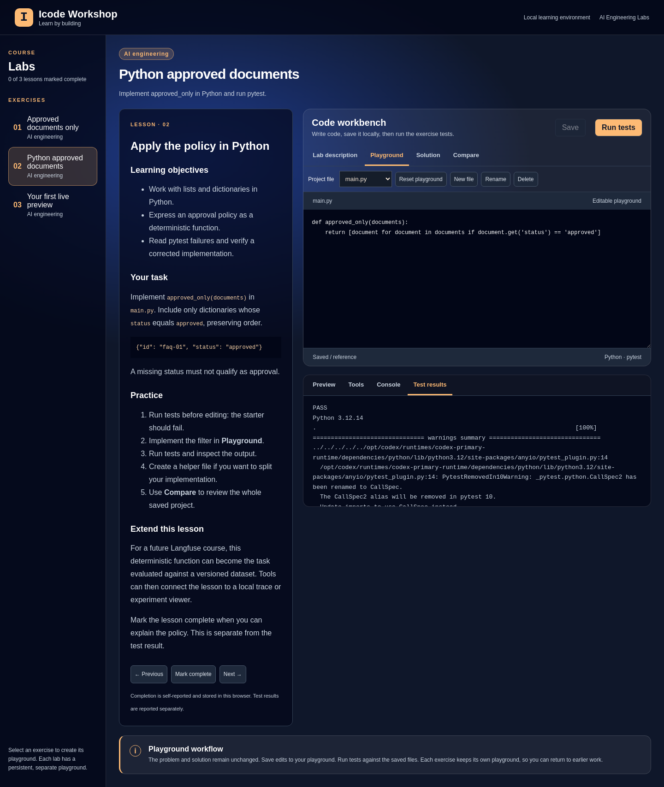

# Icode Workshop

A local-first learning workbench for programming and AI engineering. **Development preview: full Epic Workshop parity is not yet complete. PR #2 remains unmerged.**

## Running application

These are real Chromium captures from the automated learner journeys, not design mock-ups. They show the current feature branch, not a promise of the final product.




## Implemented

- Persistent Markdown lesson beside the workbench, metadata-driven lab titles, previous/next navigation and browser-local self-reported completion.
- Independent filesystem playgrounds, nested file editing, create/rename/delete, confirmed reset with backup, saved project comparison including added/deleted files.
- Real Node.js and Python test execution; automated failing-starter → passing-solution journeys.
- Managed loopback app preview with start/stop, readiness checks and a multi-file Node example.
- Per-lab Tools tabs: embedded local services when permitted, or external links when embedding is blocked.
- Versioned adapter registry, TypeScript contract, explicit third-party module loading, author conformance helper and cancellable process/session helper.

## Run locally

Prerequisites: Node.js 22+, pnpm 10, Python 3 and pytest for Python labs.

```sh
pnpm install --frozen-lockfile
python3 -m pip install pytest
# Terminal 1
node packages/web/server.mjs
# Terminal 2
pnpm --dir packages/web dev
```

Open http://127.0.0.1:5173. Labs 01/02 teach an approval filter in Node/Python. Lab 03 demonstrates a real live preview. Workspaces live at `examples/.workshop/playgrounds/<id>/`. Reset keeps the previous directory as `<id>.backup-<timestamp>`; restoring a backup is currently a manual filesystem operation.

Only run trusted local exercises and adapters. Code executes with your local permissions; loopback binding, Host/Origin checks and file validation are not an execution sandbox. Do not expose the API publicly. The file editor excludes dotfiles, generated directories, binary content and files over 100 KB. Symlinks are rejected by file operations; concurrent external filesystem mutation is outside the threat model.

`WORKSHOP_CONTENT` selects an external content directory containing `exercises/<id>/lab.json`, `README.md`, `problem/` and `solution/`. `WORKSHOP_API_PORT` changes the API port (also update the Vite proxy). `WORKSHOP_ADAPTERS` explicitly lists installed plugin modules as a JSON array. See the [adapter contract](packages/adapter-api/README.md).

## Verify

```sh
pnpm test
pnpm --dir packages/web build
pnpm exec playwright install chromium
pnpm test:browser
```

CI installs Python/pytest, runs unit/integration tests, builds React, runs Chromium acceptance tests and uploads screenshot evidence. Browser tests use disposable content directories. An optional `PLAYWRIGHT_CHROMIUM_EXECUTABLE` selects an already installed browser for restricted environments.

The original CLI remains available (`pnpm workshop list --content ./examples`). Its single `examples/playground` path is not yet unified with the web application's per-lab workspace paths.

## Parity and roadmap

The Epic Workshop tutorial was run locally and its home and exercise pages inspected. Icode now keeps instructions beside the working area, but it does **not** yet match Epic's complete workflow. Remaining work includes module/step hierarchy, runnable problem/solution variants, cross-step comparison/migration, rich video/transcript support, editor links, keyboard shortcuts, streaming diagnostics, and broader CLI/content integration.

Rust, C#/.NET and Jupyter remain future adapters. The registry accepts new runtime IDs without changes to the core, but no corresponding real toolchain has been verified yet.

- [Evidence-based parity audit](docs/feature-parity-audit.md)
- [Runtime architecture](docs/multi-language-architecture.md)
- [Langfuse, evaluation courses and embedded tools](docs/local-tools-and-ai-courses.md)
- [Development PR #2](https://github.com/IcodeNet/Icode-workshop/pull/2)

No package has been published. Full parity, cross-platform process cleanup and real Langfuse/Cosmos integrations remain release gates.
