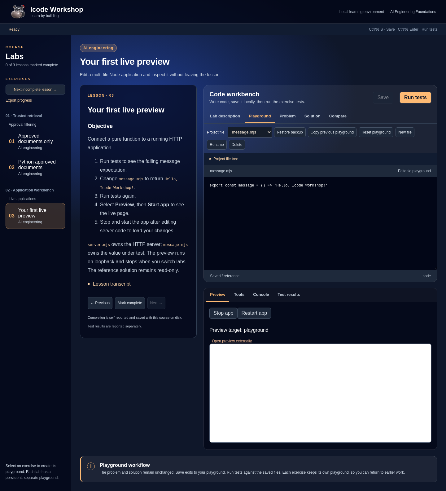

# Icode Workshop

A local-first learning workbench for programming and AI engineering. **Development preview: full Epic Workshop parity is not yet complete. PR #2 remains unmerged.**

## Running application

These are real Chromium captures from the automated learner journeys, not design mock-ups. They show the current feature branch, not a promise of the final product.




## Implemented

- Persistent Markdown lessons, module → exercise → step navigation, next-incomplete navigation and course-scoped completion saved on disk.
- Independent filesystem playgrounds, a browsable file tree, create/rename/delete, reset and in-app backup restore, cross-step copying and arbitrary saved-project comparisons.
- Real Node.js and Python execution with streamed output, elapsed activity status, cancellation, save/run shortcuts and automated failing-starter → passing-solution journeys.
- Managed loopback preview with start/stop/restart and readiness checks. Problem/Solution tests and previews run in disposable copies; authored sources remain unchanged.
- Hippo branding and favicon; optional authored video/captions/Markdown transcript; progress export.
- Per-lab Tools tabs: embedded local services when permitted, or external links when embedding is blocked.
- Versioned adapter registry, TypeScript contract, explicit third-party module loading, author conformance helper and cancellable process/session helper.

## Run locally

Prerequisites: Node.js 22+, pnpm 10, Python 3 and pytest for Python labs.

```sh
pnpm install --frozen-lockfile
python3 -m pip install pytest
# Terminal 1
node packages/web/server.mjs
# Terminal 2
pnpm --dir packages/web dev
```

Open http://127.0.0.1:5173. Labs 01/02 teach an approval filter in Node/Python. Lab 03 demonstrates a real live preview. Workspaces live at `examples/.workshop/playgrounds/<id>/`. Reset/replacement keeps a backup beside the playground; Restore Backup recovers a selected saved state and preserves current files in another backup.

Only run trusted local exercises and adapters. Code executes with your local permissions; loopback binding, Host/Origin checks and file validation are not an execution sandbox. Do not expose the API publicly. The file editor excludes dotfiles, generated directories, binary content and files over 100 KB. Symlinks are rejected by file operations; concurrent external filesystem mutation is outside the threat model.

`WORKSHOP_CONTENT` selects an external content directory containing `exercises/<id>/lab.json`, `README.md`, `problem/` and `solution/`. `WORKSHOP_API_PORT` changes the API port and Vite proxy together. `WORKSHOP_ADAPTERS` explicitly lists installed plugin modules as a JSON array. See the [adapter contract](packages/adapter-api/README.md).

## Verify

```sh
pnpm test
pnpm --dir packages/web build
pnpm exec playwright install chromium
pnpm test:browser
```

CI installs Python/pytest, runs unit/integration tests, builds React, runs Chromium acceptance tests and uploads screenshot evidence. Browser tests use disposable content directories. An optional `PLAYWRIGHT_CHROMIUM_EXECUTABLE` selects an already installed browser for restricted environments.

The CLI uses the same per-step playgrounds as the UI. Run `pnpm workshop validate --content ./examples`, `pnpm workshop start --content ./examples`, or `pnpm workshop test 01 --content ./examples`. See [course authoring](docs/course-authoring.md) for the complete workflow. Old core helper APIs remain for compatibility; new CLI commands do not use the legacy single playground.

## Parity and roadmap

The Epic Workshop tutorial was run locally and its home and exercise pages inspected. Icode now keeps instructions beside the working area, but it does **not** yet match Epic's complete workflow. The current branch adds hierarchy, runnable references, cross-step comparison/copy, authored media, shortcuts, streamed output and a unified CLI. Full parity still includes unresolved capabilities and external integrations; see the explicit release-gate table in the audit. Editor deep links, three-way migration, automated transcription and structured test diagnostics are not yet implemented.

Rust, C#/.NET and Jupyter remain future adapters. The registry accepts new runtime IDs without changes to the core, but no corresponding real toolchain has been verified yet.

- [Course authoring and persistence](docs/course-authoring.md)
- [Evidence-based parity audit](docs/feature-parity-audit.md)
- [Runtime architecture](docs/multi-language-architecture.md)
- [Langfuse, evaluation courses and embedded tools](docs/local-tools-and-ai-courses.md)
- [Development PR #2](https://github.com/IcodeNet/Icode-workshop/pull/2)

No package has been published. Full parity, cross-platform process cleanup and real Langfuse/Cosmos integrations remain release gates.
