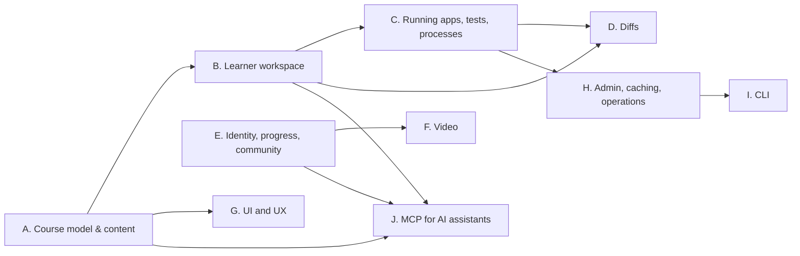

# Epic Workshop feature graph and Icode gap analysis

Source: `epicweb-dev/epicshop` at `12089440399689c914f3e0f69b3ec52c07b9a3a8` (2026-11-13). Icode: `IcodeNet/Icode-workshop` `main` at `64f1fec`.

## Method

1. **Dependencies** — every `package.json` (19) and every import site: [`dependencies.md`](dependencies.md), raw data `data/dependencies.json`.
2. **Code surfaces** — every route file in `packages/workshop-app/app/routes` (81, with loader/action/component and form intents), every exported function in `packages/workshop-utils/src` (42 modules), every process start (`execa`/`spawn`/`exec`/`fkill`, 78 sites), every environment variable (39), every CLI command (18), MCP tools (18), resources (8) and prompts (1), the configuration schema, the 34 UI components and the 14 docs: `data/features.json`.
3. **Features** below group those surfaces by what a learner, author or operator can do. Each row cites the Epic files that implement it and the Icode files (or their absence) that establish its status.
4. **Observation**: the example workshop was run end to end (Playwright walkthrough, CLI, MCP over stdio, deployed mode) and every row was checked against what it did: [`e2e.md`](e2e.md). Rows marked *Observed:* were refined or corrected by that run.

Stage 2 (workspace and diffs, [`../stage2-workspace-diffs.md`](../stage2-workspace-diffs.md)) updated rows B1–B3, B5–B7, D1, D2, I3, I4 and J2. Stage 3 (content, [`../stage3-content.md`](../stage3-content.md)) updated rows A1, A3–A5, A7–A10, C2, C5 and C9. Other rows still describe `64f1fec`.

Status: **Covered** (equivalent or better behaviour exists and is tested), **Partial** (some of the behaviour), **Gap** (absent), **Icode-only** (Icode has it, Epic does not). "Gap" is a claim about Icode `main` at `64f1fec`, checked against its source.

Paths: `app/` = `packages/workshop-app/app/`, `utils/` = `packages/workshop-utils/src/`, `cli/` = `packages/workshop-cli/src/`, `mcp/` = `packages/workshop-mcp/src/`. Icode: `web/` = `packages/web/`, `core/`, `cli/`, `mcp/` = `packages/mcp/`.

## Feature graph (domains)



## A. Course model and content

| ID | Feature | Epic evidence | Key deps | Icode today | Status |
|---|---|---|---|---|---|
| A1 | Workshop config in `package.json#epicshop`: title, subtitle, instructor (name, avatar, X handle), product (host, names, logo, slug), GitHub repo/root links | `utils/config.server.ts` (WorkshopConfigSchema), `docs/configuration.md` | zod | `course.json` title, subtitle, instructor (name, URL, avatar), product (name, URL, logo), repository; Epic `package.json#epicshop` title, subtitle, instructor (avatar, X handle), product (displayName, host, logo), `githubRoot`/`githubRepo`, validated and shown on Course home (`web/content-config.mjs`; Stage 3) | Covered (Stage 3; `product.slug`/Discord IDs belong to E1/E5) |
| A2 | Discovery of exercises, steps, problem/solution apps, first-step apps, playground, examples and extras | `utils/apps.server.ts` (isProblemApp, isExtraApp, isExampleApp…), `docs/workshop-structure.md` | globby, chokidar | Native `exercises/NN` + Epic layout adapter (`core/layout.mjs`); no extras/examples | Partial |
| A3 | App types: simple (HTML/JS served by the workshop), project (own `dev` script), **export** (compiled with esbuild, exports shown in the UI), non-UI | `app/utils/compile-app.server.ts`, `app/routes/_app+/app.$appName+/index.ts`, `docs/configuration.md#export-apps` | esbuild, etag, mime-types | Simple apps served by the workshop on a separate sandbox origin (TS/JSX bundled with esbuild, course-root guard), **export** apps (console output and exports, Epic `appType: "export"`), project apps via Stage 1 previews (`web/sandbox.mjs`, `lab.json#app`; Stage 3) | Covered (Stage 3; apps never run on the UI/API origin) |
| A4 | MDX lessons: Shiki code blocks with line highlights, callouts, autolinked headings, GFM, emoji, Mermaid, components `InlineFile`, `LinkToApp`, `DiffLink`, `Next/PrevDiffLink`, `VideoEmbed`, `EpicVideo` *Observed:* Mermaid falls back to client-side rendering when the render worker is unreachable; `DiffLink`/`Next`/`PrevDiffLink` exist only in step MDX (an exercise intro using one fails with a server error). | `utils/compile-mdx.server.ts`, `app/utils/mdx.tsx`, `app/components/mermaid.tsx`, `docs/mdx.md` | mdx-bundler, unified, remark-*, rehype-*, @kentcdodds/md-temp, mermaid | Server-side pipeline: MDX subset rewritten (never evaluated), GFM, emoji shortcodes, raw HTML through an allowlist sanitiser and explicit URL policy, Shiki dual-theme highlighting with titles/line highlights, Epic callouts and GFM alerts, `InlineFile`, `LinkToApp`, `DiffLink`/`Next`/`PrevDiffLink`, `EpicVideo`/`VideoEmbed` as link cards, heading anchors and TOC; Mermaid in an opaque sandboxed frame from the bundled ESM build without elk (offline, no main-page fallback); size, nesting and off-thread time limits; diff links on course pages inactive instead of failing (`web/markdown.mjs`, `src/content.jsx`; Stage 3) | Covered (Stage 3; fixes Epic's intro DiffLink crash and main-page Mermaid fallback) |
| A5 | Workshop intro/finished pages, exercise intro/finished pages, step navigation, "what's next" | `app/routes/_app+/index.tsx`, `finished.tsx`, `exercise+/$exerciseNumber.tsx`, `$exerciseNumber_.finished.tsx` | react-router | Course home (metadata, intro, outline, Start/Continue), workshop finished page (completion, feedback form, next step), exercise intro/wrap-up documents, "last step of the exercise" card with exercise form and next exercise (`web/content-routes.mjs`, `src/content.jsx`; Stage 3) | Covered (Stage 3) |
| A6 | Retrieval practice and interleaved quizzes (AI-generated questions about completed material) | `app/components/retrieval-practice.tsx`, `mcp/prompts.ts` (`quiz_me`), `get_quiz_instructions` tool, `docs/other.md#interleaved-practice` | @modelcontextprotocol/sdk, sonner | None | Gap |
| A7 | Workshop notifications (config + remote JSON5 feed, expiry, mute) | `utils/notifications.server.ts`, `app/routes/admin+/notifications.tsx` | json5 | `course.json#notifications`, Epic `epicshop.notifications`, optional https JSON/JSON5 feed (5 s, 64 KB, no redirects/cookies, 1 h cache, offline-silent, `ICODE_NOTIFICATIONS_FEED=0`), expiry, per-learner mute (`web/notifications.mjs`; Stage 3) | Covered (Stage 3) |
| A8 | Feedback forms per workshop/exercise with pre-filled URL templates | `config.server.ts` (`forms`), `docs/other.md#forms` | — | `forms.workshop`/`forms.exercise` https templates (`{workshopTitle}`, `{exerciseTitle}` URL-encoded), Epic `epicshop.forms`; links on finished pages, never embedded (Stage 3) | Covered (Stage 3) |
| A9 | In-app guide, workspace-structure, support and Discord pages | `app/routes/_app+/guide.tsx`, `support.tsx`, `discord.tsx` | — | Built-in Guide with the step's workspace structure, Support (`course.json#support`) and Community link (`course.json#community`) pages (Stage 3) | Covered (Stage 3; Discord chat itself is E5) |
| A10 | Per-app config overrides: `initialRoute`, `testTab.enabled`, `stackBlitzConfig`, `appType` | `config.server.ts` (`getAppConfig`) | zod | `lab.json#app` (`type`, `entry`, `initialRoute`, `browserTests`), `testTab: false`, `cloudEditor`; Epic per-app `epicshop.appType`, `initialRoute`, `testTab.enabled`, `stackBlitzConfig` (Stage 3) | Covered (Stage 3) |
| A11 | Navigation shortcuts: `/l` jumps to the last step's solution, a step URL without type opens the problem (observed in [e2e](e2e.md)) | `app/routes/_app+/l.tsx`, `exercise+/$exerciseNumber_.$stepNumber.index.tsx` | react-router | In-app module/lesson navigation, no URL shortcuts (`web/src/main.jsx`) | Gap |

## B. Learner workspace

| ID | Feature | Epic evidence | Key deps | Icode today | Status |
|---|---|---|---|---|---|
| B1 | Set the playground from any problem/solution app, with **pre/post set-playground hooks** run as Node scripts *Observed:* hooks run with `EPICSHOP_PLAYGROUND_*` env; `IS_STILL_RUNNING` is passed as `"[object Promise]"` (un-awaited), so `RESTART_PLAYGROUND` is always false. | `app/routes/set-playground.tsx`, `utils/apps.server.ts` (`setPlayground`, execa of `pre/post-set-playground`) | execa, fs-extra | Every operation that sets a playground (create, reset, replace, migrate, restore) runs course hooks as owned process trees with timeouts, Processes-tab stop and Console output; native `course.json`/`lab.json#hooks` (npm scripts) and Epic `epicshop/*-set-playground.js`; awaited structured context (`ICODE_HOOK_CONTEXT`, `EPICSHOP_PLAYGROUND_*` with real booleans); running preview restarted (`web/hooks.mjs`, `web/playground-ops.mjs`; Stage 2) | Covered (Stage 2; fixes Epic's `[object Promise]`) |
| B2 | **Saved playgrounds** history and persistence, restore any previous playground *Observed:* opt-in via a preference; one timestamped copy per set under `<workshop>/saved-playgrounds/`, never pruned. | `app/routes/saved-playgrounds.tsx`, `persist-playground.tsx`, MCP `list_saved_playgrounds`/`set_saved_playground` | fs-extra | Bounded (count, size) saved playgrounds per step, byte-for-byte except `node_modules` and declared build output (root-anchored; nested `src/bin` etc. kept): automatic before every replacement (preference) and manual with labels; restore (undoable, dependencies kept), diff, pin, delete; strict ids, never paths from labels (`web/saved-playgrounds.mjs`, Saved tab, `workshop saved`; Stage 2) | Covered (Stage 2; bounded, unlike Epic; backups bounded too) |
| B3 | Touched files: which files a step changes, with links to open them | `exercise+/…/__shared/touched-files.tsx` | @radix-ui/react-popover | Files for this step (problem → solution) with first changed line and the learner's state (not started, edited, matches solution, missing, extra); open in playground at line or GUI editor, diff, reset file (`/api/touched`, `web/src/workspace.jsx`; Stage 2) | Covered (Stage 2) |
| B4 | App file explorer and file preview in the browser *Observed:* the explorer UI is used only for apps with no `package.json` and no index file (dev type `file`); other apps expose the file list API only. | `app/components/file-app-explorer.tsx`, `routes/_app+/app.$appName+/files.ts`, `file-preview.ts` | globby, mime-types | Multi-file editor with create/rename/delete (`web/files.mjs`) | Covered (Icode edits in-browser) |
| B5 | **Launch editor**: detects installed editors, opens file at line/column, `EPICSHOP_EDITOR`/`EDITOR`/`VISUAL`, Windows command handling *Observed:* with no GUI editor running, the inherited `EDITOR=vi` (exported by npm/npx) makes a click spawn `vi` inside the workshop's terminal. | `utils/launch-editor.server.ts` (717 lines), `routes/launch-editor.tsx` | execa, shell-quote | Detected editors at line/column with argument arrays (Stage 1); `$EDITOR=vi` is never a fallback, only an explicit choice (Stage 2, `web/editors.mjs`); touched files open at the changed line | Covered (Stage 1 + 2; fixes Epic's vi-in-terminal) |
| B6 | Workshop **update**: git fetch/compare, update local repo, run `scripts.postupdate`, update banner, exercise-change detection | `utils/git.server.ts` (20 process sites), `app/components/update-repo.tsx` | execa, semver | Update tab and `workshop update`: offline-safe fetch (no prompts), incoming commits and changed lessons, typed `update` confirmation, dirty-tree refusal or exact-path stash, `--ff-only` merge only, refusal of upstream changes to `.workshop/` and of overwriting ignored/untracked files (or exact-path backup), reinstall of changed package roots, `postUpdate` hook, startup fetch with update banner (Epic `epicshop.scripts.postupdate` without a shell) (`web/update.mjs`; Stage 2) | Covered (Stage 2, incl. update banner) |
| B7 | **Package install check**: detects missing/outdated installs in root and workspaces and shows the command | `utils/package-install/package-install-check.server.ts` | execa | Install check for the course root against `package-lock.json` (Stage 1) and every independent package root, excluding workspace members, with exact commands in `doctor`, the setup banner and update reinstall (`web/setup.mjs`; Stage 2) | Covered (Stage 1 + 2) |
| B8 | Browser editing of learner files | — (Epic relies on the learner's editor) | — | In-browser editor, save, reload from disk | Icode-only |

## C. Running apps, tests and processes

| ID | Feature | Epic evidence | Key deps | Icode today | Status |
|---|---|---|---|---|---|
| C1 | Start/stop/restart an app's dev server, port allocation, **stop whatever holds a port** *Observed:* Stop App kills only the spawned `npm` process; the app's children kept the port, and the `stop-port` fallback (`fkill :port`) needs `ss` on Linux, so the port stayed held. | `app/routes/start.tsx` (intents start, stop, restart, stop-port), `utils/process-manager.server.ts` (`runAppDev`, `waitOnApp`) | get-port, find-process, fkill | Preview start/stop with owned process trees and port checks (`web/previews.mjs`) | Partial |
| C2 | Preview hosting: simple apps served by the workshop, app API proxy, **in-browser browser** (address bar, back/forward), preview tabs, open in new tab | `routes/_app+/app.$appName+/$.ts`, `api.$.ts`, `components/in-browser-browser.tsx`, `preview-tabs.tsx` | express, mime-types | Workshop-served simple/export apps on the sandbox origin; in-workshop browser (address bar limited to paths, back/forward via an injected location script, reload, open in new tab), variant tabs (playground/problem/solution) for apps and previews (`src/content.jsx` `AppBrowser`; Stage 3). Epic's in-process app API (`api.server.ts` executed by the workshop server) is deliberately not provided: apps with a backend use a Stage 1 preview | Partial (Stage 3; everything except Epic's in-process app API) |
| C3 | **Live reload**: WebSocket script injected into apps; file changes revalidate the UI *Observed:* reloads workshop-served (browser) apps and lesson content; apps with their own dev server rely on that server's HMR. | `routes/_app+/app.$appName+/epic_ws[.js].ts`, `components/revalidation-ws.tsx`, `server/index.ts` | ws, chokidar | Manual "Reload file" | Gap |
| C4 | Test runner as a managed process with streamed stdout/stderr (SSE), ANSI colours, stop, clear *Observed:* when `product.slug` is set, the tests tab and `/test` require login plus workshop access (403 otherwise). | `routes/test.tsx` (intents run, stop, clear), `process-manager.server.ts` (`runAppTests`), `utils/ansi-text.ts` | remix-utils SSE, ansi-to-html | Streamed tests with cancellation (`/api/test-stream`); plain text output | Partial |
| C5 | **In-browser tests**: test files executed inside the running app page with `testStep`/`expect`, results shown per step *Observed:* same access gate as C4; `setupInBrowserTests` (Playwright) runs every solution's browser tests headlessly. | `components/in-browser-test-runner.tsx`, `utils/test.ts`, `utils/playwright.server.ts`, `docs/testing.md` | @vitest/expect, chai, chai-dom, @testing-library/*, @playwright/test, cross-spawn | In-browser tests in the app page on the sandbox origin: native `lab.json#app.browserTests`, Epic `*.test.*` in simple apps; `@epic-web/workshop-utils/test` and `@icodenet/workshop-test` aliased to the engine runtime (`testStep`, `expect`, `dtl`); per-step results by origin-checked `postMessage`; 30 s timeout; **no login gate** (`web/browser-test-runtime.mjs`; Stage 3) | Partial (Stage 3; learner runner covered and ungated; Epic's headless `setupInBrowserTests` author run not built) |
| C6 | **Sidecar processes**: course-configured commands started with the workshop, coloured prefixed logs, restart, logs in admin *Observed:* restarting a sidecar or stopping the workshop leaves the old sidecar's child processes running. | `process-manager.server.ts` (`startSidecarProcesses`, `restartSidecarProcess`, `getSidecarLogs`), `docs/configuration.md#sidecar-processes` | execa | None | Gap |
| C7 | **Processes view**: list running app/test/sidecar processes and close them | `routes/processes.tsx`, `process-manager.server.ts` (`getProcesses`, `closeProcess`) | fkill | None | Gap |
| C8 | Node **inspector** toggle for the workshop server | `routes/admin+/index.tsx` (intents inspect, stop-inspect) | — | None | Gap |
| C9 | **StackBlitz**: open any app in StackBlitz (title, start script, view, file) *Observed:* URLs are computed for every app but shown only in deployed mode, as an embedded preview. | `config.server.ts` (`getStackBlitzUrl`), `docs/other.md#stack-blitz-support` | — | Open the problem or solution in StackBlitz (Epic URL format, `stackBlitzConfig` overrides, `null`/`false` hides), CodeSandbox or GitHub from validated repository settings; shown locally, not only in deployed mode (Stage 3) | Covered (Stage 3) |
| C10 | Course-defined actions run from the UI with typed confirmation and a running-cost banner | — (not in Epic) | — | Not built yet | Gap in both (Icode plan) |
| C11 | Multi-language execution: Python, Rust, .NET, Jupyter, Docker Compose adapters | — | — | `adapter-api/*` | Icode-only |

## D. Diffs

| ID | Feature | Epic evidence | Key deps | Icode today | Status |
|---|---|---|---|---|---|
| D1 | Diff any two apps (playground, problem, solution, other steps) with ignore rules, rich renderer, per-file accordion, caching *Observed:* the diff UI is access-gated like C4; the same diffs are available ungated via CLI `diff` and MCP diff tools. | `utils/diff.server.ts`, `routes/diff.tsx`, `components/diff.tsx`, `docs/diff.md` | parse-git-diff, ignore, @pierre/diffs, execa (git diff) | Rich diff of any two of problem, solution, playground or saved playground of any steps: side-by-side/unified, word highlights, ignore whitespace, context, per-file accordion, binary/large/deferred handling, gitignore-style rules incl. `epicshop/.diffignore`, renames; JS engine with budgets; not login-gated (`web/diff.mjs`, `web/src/diff.jsx`; Stage 2) | Covered (Stage 2; no cache layer needed, no gate) |
| D2 | Diff **sync shortcuts** (`/diff/:shortcut`) and lesson `DiffLink`s | `routes/diff.$shortcut.tsx`, MDX `DiffLink` | — | `?diff=` deep links and shortcuts (`01`, `01..02`, `01.playground`), lesson `#diff=step|next|prev|a..b` links, keyboard shortcuts, per-file sync into a playground (`/api/file/sync`; Stage 2) | Covered (Stage 2) |

## E. Identity, progress and community

| ID | Feature | Epic evidence | Key deps | Icode today | Status |
|---|---|---|---|---|---|
| E1 | **Login**: OAuth device-code flow to the product host, login status via SSE, logout, account page *Observed:* a device-code failure after the login page was left crashed the whole workshop server (write to a closed SSE stream). | `app/utils/auth.server.ts`, `routes/_app+/login.tsx`, `login-sse.tsx`, `account.tsx`, `cli/commands/auth.ts` | openid-client | None | Gap (self-hostable identity needed) |
| E2 | **Progress**: per-lesson progress synced to the product API with an offline mutation queue, progress page | `utils/epic-api.server.ts` (1,484 lines), `routes/progress.tsx`, `mcp update_progress` | @epic-web/cachified | Local completion and export (`web/course.mjs`) | Partial |
| E3 | Entitlements: what the user has access to *Observed:* access gates the tests tab, in-browser tests and diff UI (C4, C5, D1). | `epic-api.server.ts`, MCP `get_user_access` | — | None | Gap |
| E4 | **Presence**: who else is on this workshop/step, opt-out | `packages/workshop-presence` (Cloudflare Durable Object), `app/utils/presence.tsx`, `account.tsx` (presence-opt-out) | partyserver, partysocket | None | Gap |
| E5 | **Discord** chat per workshop/exercise | `components/discord-chat.tsx`, `docs/launch.md` | — | None | Gap |
| E6 | **Onboarding indicators**: discoverability badges and callouts, completion stored per user | `components/onboarding-indicator.tsx`, `routes/mark-onboarding-complete.tsx`, `docs/onboarding-indicators.md` | — | None | Gap |
| E7 | Celebrations: confetti on completion | `components/confetti.tsx`, `app/utils/confetti.server.ts` | confetti-react | None | Gap |

## F. Video

| ID | Feature | Epic evidence | Key deps | Icode today | Status |
|---|---|---|---|---|---|
| F1 | Video player: keyboard shortcuts, speed, frame-by-frame, volume, PiP, fullscreen, captions, quick seek, focus handling, native-player preference | `components/epic-video.tsx`, `routes/video-player/index.tsx`, `docs/video-player.md` | @mux/mux-player-react, media-chrome | HTML video with captions and transcript (`web/src/main.jsx`) | Partial |
| F2 | **Offline videos**: download per quality, encrypted at rest, progress events, offline playback, manage in preferences/admin | `utils/offline-videos.server.ts` (1,422 lines), `offline-video-crypto.server.ts`, `routes/resources+/offline-videos*.ts`, `admin+/offline-videos.tsx` | @react-router/node | None | Gap |
| F3 | Video metadata and transcripts from the product API | `epic-api.server.ts` (`getEpicVideoInfos`) | — | Author-provided transcript and captions | Partial |

## G. UI and UX

| ID | Feature | Epic evidence | Key deps | Icode today | Status |
|---|---|---|---|---|---|
| G1 | **Command palette** with fuzzy search across exercises and actions | `components/command-palette.tsx`, `app/utils/command-palette.ts` | @radix-ui/react-dialog, match-sorter | None | Gap |
| G2 | Keyboard shortcuts dialog *Observed:* also vim-style `g`+key navigation and `s p` (set playground) shortcuts. | `components/keyboard-shortcuts-dialog.tsx` | — | Save/run shortcuts only | Partial |
| G3 | Theme: light/dark/system via client hints and cookie | `routes/theme/*`, `app/utils/client-hints.tsx`, `docs/styling-and-theming.md` | @epic-web/client-hints, @conform-to/* | None | Gap |
| G4 | Preferences page (player, presence, offline video quality) *Observed:* also font size, persist playground and exercise-warning dismissal. | `routes/_app+/preferences.tsx` | — | None | Gap |
| G5 | Connection/offline status, status indicator, error boundaries per panel | `routes/resources+/connection-status.tsx`, `utils.server.ts` (`checkConnection`), `components/status-indicator.tsx`, `error-boundary.tsx` | react-error-boundary | Errors shown inline | Partial |
| G6 | Exercise warning banner (e.g. playground differs from the current step) *Observed:* also a red banner whenever files under `exercises/` change. | `components/exercise-warning-banner.tsx` | — | None | Gap |
| G7 | SEO for deployed workshops: OG images, sitemap, robots *Observed:* the OG image fetches Google Fonts and jsDelivr at request time (500 offline). | `routes/og.tsx`, `sitemap[.]xml.ts`, `robots[.]txt.ts` | satori, @resvg/resvg-js, @nasa-gcn/remix-seo | None | Gap |
| G8 | Scroll restoration in lesson panels | `@epic-web/restore-scroll` in 7 routes | @epic-web/restore-scroll | None | Gap |
| G9 | Accessibility-tested responsive layout | Playwright/vitest browser tests | — | Mobile layout and keyboard tests (`tests/browser`) | Covered |

## H. Admin, caching and operations

| ID | Feature | Epic evidence | Key deps | Icode today | Status |
|---|---|---|---|---|---|
| H1 | **Admin dashboard**: clear caches/data, sidecar logs and restart, inspector, instructions, finished pages | `routes/admin+/index.tsx` (1,031 lines; intents clear-caches, clear-data, get-sidecar-logs, restart-sidecar, inspect, stop-inspect, …) | — | None | Gap |
| H2 | **Cache manager**: browse, edit, delete entries; workshop cache metadata | `routes/admin+/cache.tsx` (1,141 lines), `utils/cache.server.ts`, `workshop-cache-metadata.server.ts` | @epic-web/cachified, lru-cache, md5-hex | No cache layer | Gap |
| H3 | Version page, local data/DB viewer | `routes/admin+/version.tsx`, `db.tsx`, `utils/db.server.ts` | zod | None | Gap |
| H4 | Debug logging namespaces and verbose mode | `utils/logger.ts`, `docs/debug-logging.md`, `EPICSHOP_VERBOSE_LOG` | — | None | Gap |
| H5 | Error monitoring and tracing | `app/instrument.js`, Sentry in app/CLI/MCP | @sentry/* | None | Gap (make vendor-neutral) |
| H6 | **Deployed (hosted, read-only) mode** *Observed:* mutations return 400, admin/preferences/login are disabled, no sidecars, previews are StackBlitz embeds. | `EPICSHOP_DEPLOYED`, `docs/deployment.md` | — | Local only | Gap |
| H7 | Data storage in OS-appropriate dirs with legacy migration *Observed:* `~/.local/state/epicshop/data.json`, `~/.cache/epicshop/<instance>/`. | `utils/data-storage.server.ts` (XDG/APPDATA) | — | `.workshop/` inside the course | Partial |
| H8 | Server timing headers and request context | `utils/timing.server.ts`, `request-context.server.ts` | — | None | Gap |
| H9 | **Supervisor process**: the CLI stays as parent of the app server with a token-protected localhost restart endpoint (`EPICSHOP_PARENT_PORT`/`TOKEN`, `/__epicshop-restart`) used after updates (observed in [e2e](e2e.md)) | `cli/commands/start.ts`, `app/components/update-repo.tsx` | — | `start` runs the server directly | Gap |

## I. CLI

| ID | Feature | Epic evidence | Icode today | Status |
|---|---|---|---|---|
| I1 | `start` (context-aware default), `setup` | `cli/commands/start.ts`, `setup.ts` | `start`, `setup`, `doctor` (`cli/bin.mjs`) | Covered |
| I2 | **Multi-workshop management**: `init`, `add <repo[#ref]>`, `list`, `remove`, `open`, `config` (repos directory) | `cli/commands/workshops.ts`, `utils/workshops.server.ts` | Single course via `--content` | Gap |
| I3 | `update`/`upgrade`, `warm`, `cleanup`, `migrate` | `update.ts`, `warm.ts`, `cleanup.ts`, `migrate.ts` | `workshop update` (check, `--apply --confirm update [--stash]`); no `warm`/`cleanup`/`migrate` | Partial (Stage 2: update) |
| I4 | `auth`, `playground` (set, saved), `progress`, `diff`, `exercises` | `auth.ts`, `playground.ts`, `progress.ts`, `diff.ts`, `exercises.ts` | `set`, `reset`, `progress`, `diff <id>`, `diff <side> <side>`, `saved <id> list|save|restore`, `list`, `test`, `validate`; no `auth` | Partial (Stage 2: saved playgrounds, side diffs) |
| I5 | Interactive command chooser and programmatic API | `cli/cli.ts`, `docs/cli.md#programmatic-usage` | None | Gap |
| I6 | Author admin commands (e.g. set videos across exercises) *Observed:* `admin launch-readiness` (workshop launch checks) and `admin set-videos`. | `cli/commands/admin/*` | `validate` | Partial |
| I7 | Workshop **context export** for AI tools: `exercises context [--output]` writes all instructions, exercises, steps and files as one JSON document (observed in [e2e](e2e.md)) | `cli/commands/exercises.ts` | Read-only course/exercise/file tools over MCP (`mcp/server.mjs`); no CLI export | Partial |

## J. MCP for AI assistants

| ID | Feature | Epic evidence | Icode today | Status |
|---|---|---|---|---|
| J1 | Context tools: workshop, exercise, step, what's next | `mcp/tools.ts` (`get_workshop_context`, `get_exercise_context`, `get_exercise_step_context`, `get_what_is_next`) | Read-only course, exercise, file tools (`mcp/server.mjs`) | Partial |
| J2 | Diff tools: between apps, step progress diff *Observed:* not access-gated, unlike the diff UI. | `get_diff_between_apps`, `get_exercise_step_progress_diff` | `diff_sides` and `touched_files` MCP tools, read-only, ungated like Epic but never revealing hidden solutions (`mcp/server.mjs`; Stage 2) | Covered (Stage 2) |
| J3 | Action tools: set playground, saved playgrounds, open files in editor, update progress | `set_playground`, `list_saved_playgrounds`, `set_saved_playground`, `open_exercise_step_files`, `update_progress` | None (read-only by design) | Gap |
| J4 | User tools: login, logout, info, access, progress | `login`, `logout`, `get_user_info`, `get_user_access`, `get_user_progress` | None | Gap |
| J5 | Learning tools: quiz instructions, `quiz_me` prompt, `view_video` with interactive UI | `get_quiz_instructions`, `prompts.ts`, `view_video` (+ `@mcp-ui/server`) | None | Gap |
| J6 | Resources mirroring the context tools (8) *Observed:* exposed as 8 resource templates keyed by `workshopDirectory`. | `mcp/resources.ts` | None | Gap |

## Icode-only capabilities (keep and extend)

In-browser multi-file editor (B8); multi-language adapters (C11); AI tutor with explicit data-sharing labels; Tools panel with sandboxed embeds; native format with validation; per-step seeds; Epic-layout compatibility; hostile-origin/host/traversal protection tested in the browser.

## Counts

73 capability rows: **Covered 21, Partial 16, Gap 34, Icode-only 2** after Stage 3 (Covered 12, Partial 20, Gap 39 after Stage 2; Covered 3, Partial 24, Gap 44 at `64f1fec`; counted by `scripts/count-status.py`; A11, H9 and I7 were added after the end-to-end run in [`e2e.md`](e2e.md)). One of the gaps (C10, course actions) is absent from Epic too. Platform-maintenance tooling (Nx release, mass workshop updates, presence deployment, lint/format) is inventoried in `dependencies.md` but is not a learner or author feature.

## Build order (proposed)

1. **Run and operate (C, H core):** course actions with typed confirmation and cost banner (C10), sidecars (C6), processes view (C7), kill-port (C1), ANSI output (C4), live reload (C3), launch editor (B5), package-install check (B7), admin dashboard essentials (H1), debug logging (H4). These unblock Lab 03 inside Icode.
2. **Workspace and diffs (B, D):** pre/post playground hooks (B1), saved playgrounds (B2), touched files (B3), rich diffs, diff links and shortcuts (D1–D2), workshop update with postupdate (B6).
3. **Content (A):** full MDX components with Shiki, callouts and Mermaid (A4), export apps and in-browser browser (A3, C2), in-browser tests (C5), intro/finished pages (A5), notifications, forms, guide (A7–A9), StackBlitz (C9).
4. **UX (G):** command palette, shortcuts dialog, theme, preferences, warning banner, scroll restoration, connection status (G1–G8).
5. **Learning and MCP (A6, J):** retrieval practice and quiz, full MCP tool/resource set including safe action tools.
6. **Identity and community (E, F, H6):** self-hostable OIDC login, synced progress, entitlements, presence, Discord, onboarding, confetti, video player, offline videos, deployed mode, vendor-neutral telemetry (OpenTelemetry instead of a fixed Sentry account).

Each stage lands as an Icode-workshop PR with unit, integration and browser tests, merged only when CI is green.

## Reproduce

```sh
git clone https://github.com/epicweb-dev/epicshop && git -C epicshop checkout 12089440399689c914f3e0f69b3ec52c07b9a3a8
python3 scripts/deps.py epicshop data           # data/dependencies.json
python3 scripts/features.py epicshop data       # data/features.json
python3 scripts/dependencies-md.py data dependencies.md
python3 scripts/count-status.py README.md       # status totals
# end-to-end observation: see e2e.md (scripts/e2e-walkthrough.mjs, scripts/mcp-probe.mjs)
```
