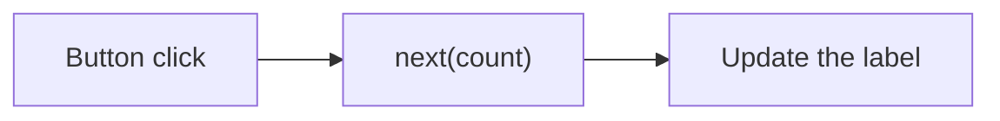

# A counter in the in-workshop browser

## Objective

Make the **Count** button add one on every click. The page is served by the workshop itself, so there is no dev server to start.

<callout-info>
  Open the **Preview** panel to see the page. It runs in a sandbox: it cannot read the workshop or call its API.
</callout-info>

## How it fits together



The page calls `next` from <InlineFile file="counter.mjs" />:

```js filename=counter.mjs {2}
export function next(count) {
  return count; // TODO: return the next count
}
```

## Check your work

1. Run the Node tests: they check `next` on its own.
2. In the **Preview** panel, run the **browser tests**: they click the real button.
3. <LinkToApp to="/">Open the app</LinkToApp> and click the button yourself.

> [!TIP]
> Browser tests import `testStep`, `expect` and `dtl` from `@icodenet/workshop-test`.

<DiffLink>Compare with the solution</DiffLink> when you are done.
