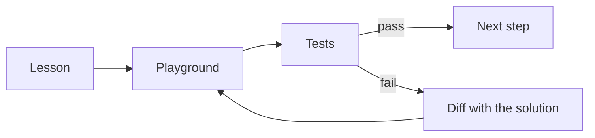

# Welcome to AI Engineering Foundations

These labs build small, testable pieces of AI applications: trusted retrieval, live applications and the data shaping around them.

## How the course works

Each step has a lesson, a starting **problem**, a reference **solution** and your own **playground**. Edit your playground, run the tests, and use the diff when you get stuck.

<callout-success>
  Everything runs locally. No account, login or network is needed.
</callout-success>
